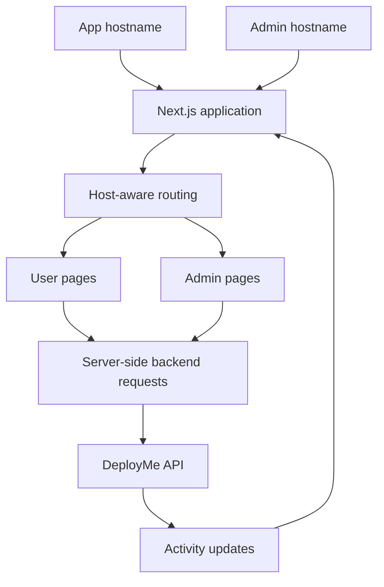

# ✨ DeployMe · Frontend

**Connect a repository. Follow the build. Open your website.**

The DeployMe frontend brings repository imports, deployment activity, project settings, team collaboration, and platform administration into one Next.js application.


[Getting started](#getting-started) · [Pages](#pages) · [Architecture](#architecture) · [Commands](#commands) · [Production](#production)

---

## The experience

DeployMe is designed to make publishing a static website straightforward:

1. Sign in using an email verification code.
2. Enter your name during first-time onboarding.
3. Connect GitHub and choose a repository.
4. Select a personal or team destination.
5. Review build settings and choose an available subdomain.
6. Start deployment and follow its output.
7. Open the website and manage the project from its dashboard.

A team is optional. Personal projects work independently of team membership.

## What is included?

| Area | Experience |
|---|---|
| Authentication | Email OTP, onboarding, session handling |
| Repository import | GitHub connection, repository picker, inspection, settings review |
| Deployment activity | Status summaries, streamed logs, historical pages, individual deployments |
| Build measurements | CPU time, peak observed memory, duration, artifacts, measurement coverage |
| Website delivery | Delivery status and website link when available |
| Project settings | Root directory, install/build commands, output directory, SPA fallback |
| Build variables | Public build-variable editing |
| Project lifecycle | Manual deployment and archive confirmation |
| Teams | Creation, invitations, membership management, leaving, ownership transfer |
| Project access | Explicit View, Deploy, and Manage grants |
| Administration | Overview, users, projects, project details, operational status, audit history |

> DeployMe currently hosts static output. The resource figures describe build execution, not an always-running server process for each website.

## Architecture



The app and admin hostnames share one Next.js process. `src/proxy.ts` chooses the route based on the requested hostname.

Server-side requests forward the session to the configured backend. Backend authorization remains authoritative; hiding a button is not a security boundary.

## Technology

- **Next.js:** 16.4.6 with the App Router
- **React:** 19.3.0
- **Styling:** Tailwind CSS 4
- **Language:** TypeScript
- **Package manager:** pnpm 12.6.0
- **Rendering:** Server and client components, Suspense, Cache Components
- **Mutations:** Server Actions
- **Activity:** Streamed deployment updates

Use the lockfile for the exact dependency set.

## Getting started

### Prerequisites

- Node.js 22 compatible with the companion backend.
- pnpm 12.6.0.
- A configured and running DeployMe backend.
- PostgreSQL, Redis, Docker, and integrations managed by that backend for full deployment functionality.

The frontend does not replace the API or deployment workers.

### 1. Install dependencies

From this repository's root:

```bash
pnpm install --frozen-lockfile
```

### 2. Create `.env.local`

```dotenv
BACKEND_URL=http://127.0.0.1:3000
APP_ORIGIN=http://localhost:3001
ADMIN_ORIGIN=http://admin.localhost:3001
```

| Variable | Meaning |
|---|---|
| `BACKEND_URL` | Backend address used by server-side requests |
| `APP_ORIGIN` | Exact public origin for the user application |
| `ADMIN_ORIGIN` | Exact public origin for the administrator application |

The app and admin hosts must differ. Use full origins with a scheme and port where required, without an application path.

Align the backend environment:

```dotenv
FRONTEND_ORIGIN=http://localhost:3001
ADMIN_ORIGIN=http://admin.localhost:3001
```

Do not put backend credentials, GitHub private keys, or database URLs into browser-exposed environment variables.

### 3. Start the app

```bash
pnpm dev
```

Open:

| Site | Local URL |
|---|---|
| User app | http://localhost:3001 |
| Admin sign-in | http://admin.localhost:3001 |
| Admin dashboard | http://admin.localhost:3001/dashboard |

If `admin.localhost` does not resolve in your environment, configure local hostname resolution to `127.0.0.1`.

Administrator pages require an authorized platform account. Visiting the admin hostname does not grant administrator privileges.

## Pages

### User application

| Path | Purpose |
|---|---|
| `/login` | Email OTP sign-in |
| `/onboarding` | First-time profile setup |
| `/dashboard` | User dashboard |
| `/new` | Repository import and deployment |
| `/projects/[projectId]` | Activity, logs, delivery, build measurements |
| `/projects/[projectId]/settings` | Project configuration and archiving |
| `/projects/[projectId]/access` | Team project sharing |
| `/teams` | Team list and creation |
| `/teams/[teamId]` | Team projects |
| `/teams/[teamId]/members` | Membership and invitations |
| `/invitations/accept` | Accept or decline an invitation |

### Administrator application

These public paths are used on the admin hostname:

| Public path | Internal Next.js route |
|---|---|
| `/` | `/login` |
| `/dashboard` | `/admin` |
| `/users` | `/admin/users` |
| `/projects` | `/admin/projects` |
| `/projects/[projectId]` | `/admin/projects/[projectId]` |
| `/health` | `/admin/health` |
| `/audit` | `/admin/audit` |

Browser navigation uses the clean public paths. Backend API paths such as `/admin/projects` remain separate.

## Deployment activity

The project activity screen connects:

- A deployment summary.
- Build-resource measurements.
- Website delivery status.
- Build logs and connection status.
- Reconnection controls.
- Links to older deployment history.
- Individual deployment views.
- Manual deployment when permission allows it.

Logs are displayed in pages of up to five deployments, oldest first within each page. Earlier pages are available through the history controls.

Users can inspect a particular deployment through the project's `deployment` query parameter.

### Understanding measurements

| Measurement | Meaning |
|---|---|
| Build duration | Elapsed build time |
| CPU time | Recorded CPU consumption across measured executions |
| Peak observed memory | Highest recorded memory sample |
| Artifact size | Output size for the deployment |
| Complete coverage | Recorded measurements cover expected executions |
| Partial coverage | Some measurements or executions may be missing |
| Unavailable | No usable sampling coverage |

A deployment marked Ready or a historical publication timestamp does not independently prove that the website is currently reachable.

## Settings and collaboration

Build commands, directories, and public build variables apply to future deployments. Saving settings does not automatically start a build.

SPA fallback can trigger a delivery-routing update without rebuilding.

Public build variables are not a secret store. Values used in frontend builds may become visible in generated browser assets.

Archiving requires the project slug as confirmation. Delivery shutdown may complete asynchronously after the project is archived.

### Team access

- Owners and managers have role-based viewing and management access to team projects.
- Deployment permission requires an explicit project grant.
- Ordinary members need explicit project access.
- A member's Manage grant does not allow changing project sharing.
- Backend checks enforce authorization for every operation.

### Invitations

Opening an invitation link only displays the response page.

The recipient must sign in with the invited email address and choose **Accept invitation** or **Decline invitation**. New invitation codes are eight characters and displayed in a visible text field. Previously issued 64-character tokens remain supported.

## Sessions and hostnames

Session cookies are:

- HTTP-only.
- Secure in production.
- SameSite=Lax.
- Scoped to the current hostname.
- Assigned the backend's fixed expiry.

The app and admin sites therefore maintain separate browser cookie contexts. Being signed in to the user app does not automatically establish an admin-host session.

## Commands

| Command | Purpose |
|---|---|
| `pnpm dev` | Development server on port 3001 |
| `pnpm typecheck` | TypeScript validation |
| `pnpm lint` | ESLint |
| `pnpm build` | Optimized production build |
| `pnpm start` | Serve the production build on port 3001 |

```bash
pnpm typecheck
pnpm build
```

A successful build validates compilation and route generation. Integration behaviour still depends on the backend and external services.

## Repository guide

| Path | Contents |
|---|---|
| `src/app` | Routes, layouts, pages, and route handlers |
| `src/components` | Shared layout and UI components |
| `src/features/auth` | Authentication actions and behaviour |
| `src/features/import` | Repository selection, inspection, deployment flow |
| `src/features/deployments` | Activity streaming, logs, deployment controls |
| `src/features/projects` | Project lists and deployment tables |
| `src/features/project-settings` | Build settings and archiving |
| `src/features/project-access` | Sharing controls |
| `src/features/teams` | Invitations and team management |
| `src/features/admin` | Administration support |
| `src/lib/server` | Backend access, hostname detection, session helpers |
| `src/proxy.ts` | App/admin hostname routing |
| `deploy/frontend.env.example` | Production environment template |

## Production

A production build has passed, and the main deployment flow has been exercised locally.

**Public production hosting is still being prepared.**

Example frontend configuration:

```dotenv
NODE_ENV=production
APP_ORIGIN=https://app.example.com
ADMIN_ORIGIN=https://admin.example.com
BACKEND_URL=http://127.0.0.1:3000
```

Replace the example hostnames. The loopback backend address assumes the API and frontend run on the same server.

Deployment templates in the backend repository cover the Linux processes and HTTPS reverse proxy. Before launch:

- Configure real DNS and HTTPS.
- Preserve the requested hostname through the reverse proxy.
- Keep session cookies secure and host-specific.
- Configure GitHub callbacks for the production app.
- Verify streamed logs through the deployed proxy.
- Complete trusted client-IP forwarding for OTP rate limiting.
- Validate the app and admin flows on the actual server.

Customer website hosting uses the platform's separate delivery infrastructure.

## Troubleshooting

| Symptom | Check |
|---|---|
| “Unrecognized application host” | Browser hostname versus `APP_ORIGIN` and `ADMIN_ORIGIN` |
| Admin projects page is missing | Admin hostname, proxy mapping, administrator session |
| API returns 404 after a backend change | Restart/rebuild the backend |
| Unable to load project activity | API availability, session, project access, stream connection |
| OTP requests are rejected | Backend origins, email delivery, rate limits |
| GitHub callback fails | Registered callback URL and production/local origin alignment |
| Website link is unavailable | Delivery status and backend publication processing |

---

Built by **Akshat Naik**.

Companion API: [deployme-server](https://github.com/EzAkshat/deployme-server)